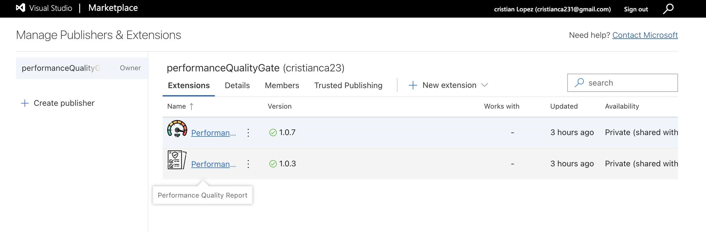

# performance-quality-gate

Compara una versión candidata contra producción, endpoint por endpoint, con resultados JMeter CSV. El programa es `tools/perfGate.py`. En Azure DevOps la misma lógica corre como la task `PerfGate@1`.

Analísis de los datos:

Tras descartar los primeros 60 segundos debido a que se evidencia que son de estabilización en las pruebas, se toma la decisión de que un endpoint comparable a producción falla si el p95 de la candidata supera 1,2 veces el de producción, o si su tasa de error supera el mínimo entre el error de producción más 1 punto y el 2 %. Con menos de 30 muestras útiles en algún lado, el endpoint queda como advertencia no concluyente. Un endpoint que desaparece en la candidata falla. Uno nuevo, sin producción contra la cual comparar, queda en advertencia.

El código de salida es 0 si pasa (las advertencias no lo dejan el pipeline marcado en rojo), 1 si algo comparable no cumple y 2 si los datos no se pueden leer o todo queda no concluyente.

Los límites viven en `perf-gate.json`. Los tokens `#{...}#` se resuelven en local a 60, 20, 1, 2 y 30. En la task se pisan con los inputs del pipeline.

## Por qué se decide que la versión B reemplaza a producción

La decisión sale de correr el mismo criterio sobre `version-a.csv` y `version-b.csv`, ambos contra `produccion-actual.csv`.

La versión B sale con código 0. Los tres endpoints con muestra suficiente se mantienen:

| Endpoint | p95 producción / B | Error producción / B |
|---|---:|---:|
| Consultar saldo, cuenta ahorros | 206 / 207 ms | 0,43 % / 0,25 % |
| GET /clientes | 162 / 162 ms | 0,00 % / 0,08 % |
| POST /pagos | 353 / 353 ms | 0,25 % / 0,08 % |

`POST /pagos` es el flujo que más pesa en la comparación: en B el p95 no se mueve y el error baja. En A ese mismo endpoint pasa de 353 ms a 767 ms (2,2 veces, +117 %) y el error sube de 0,25 % a 3,33 %, por encima del límite de 1,25 %. A termina en código 1.

Las dos advertencias de B no autorizan esos endpoints. `GET /reportes` solo tiene 3 muestras de cada lado, por debajo de 30, así que el salto de p95 (819 ms a 2421 ms) no se puede tratar como regresión ni como aprobación. `POST /transferencias` no existe en producción: antes de darlo por bueno hace falta un límite absoluto acordado con el equipo. Esas dos advertencias también están en A, y no compensan el fallo de `POST /pagos`.

B reemplaza a producción porque los endpoints que sí se pueden comparar cumplen el criterio. No es una aprobación de capacidad ni de los dos puntos que quedaron en seguimiento.

## Uso en local

Hace falta tener Python 3.10 o superior. El validador usa solo la biblioteca estándar.

Desde la raíz del repositorio:

```bash
python3 tools/perfGate.py \
  --baseline data/produccion-actual.csv \
  --candidate data/version-b.csv \
  --config perf-gate.json \
  --report artifacts/reporte.md \
  --html-report artifacts/reporte.html
```

El Markdown se imprime en la consola y, si pasas `--report` y `--html-report`, también queda en disco. `artifacts/reporte.html` se abre en el navegador.

Para evaluar la versión A, usa `data/version-a.csv` como candidato.

Argumentos:

| Argumento | Uso |
|---|---|
| `--baseline`, `--candidate` | Archivos de producción y de la candidata. Obligatorios. |
| `--baseline-format`, `--candidate-format` | `jmeter` (CSV) o `k6` (futura mejora y estabilización) (JSON). Por defecto, `jmeter`. |
| `--config` | JSON de límites. Obligatorio. |
| `--report`, `--html-report` | Rutas de salida. Opcionales. |
| `--warmup-seconds` | Pisa `warmupSeconds`. |
| `--max-p95-regression-pct` | Pisa el aumento máximo del p95, en porcentaje. |
| `--max-error-increase-pp` | Pisa el aumento máximo de error, en puntos. |
| `--max-error-rate-pct` | Pisa el tope de error. |
| `--min-samples` | Pisa el mínimo de muestras. |
| `--endpoints-file` | JSON cuyas claves son nombres de endpoint y cuyos valores pisan los límites de ese endpoint. `warmupSeconds` no se acepta ahí. |

Ejemplo de límites por endpoint:

```json
{
  "POST /pagos": { "maxP95RegressionPct": 10, "minSamples": 50 }
}
```

## Empaquetar las extensiones

La creación de las extensiones se basa en [Package, publish, and install extensions](https://learn.microsoft.com/en-us/azure/devops/extend/publish/overview?view=azure-devops): manifiesto `vss-extension.json`, empaquetado con TFX, publicación en el Visual Studio Marketplace y compartido con la organización antes de instalarlas.

Hay dos extensiones, las dos con publisher `cristianca23`:

- **Performance Quality Gate** (`extension/`, id `performance-quality-gate`, versión 1.0.7). Aporta la task `PerfGate@1`.
- **Performance Quality Report** (`report-extension/`, id `performance-quality-report`, versión 1.0.3). Aporta la task que adjunta el HTML y la pestaña **Reports** de la etapa del release.

Este comando copia cada extensión a un directorio temporal, incluye en la task del quality gate los módulos de `tools/` y `perf-gate.json`, y genera los dos `.vsix` en `dist/`:

```bash
python3 tools/packageExtension.py
```

Necesita Node.js, porque llama a `tfx-cli` 0.21.1. Para dejar solo la copia, sin `.vsix`:

```bash
python3 tools/packageExtension.py --stage-only --output dist/staging
```

Para publicar y compartir con la organización:

```bash
npx tfx-cli@0.21.1 extension publish \
  --vsix dist/cristianca23.performance-quality-gate-1.0.7.vsix \
  --share-with performance-quality-gate \
  --token "$AZURE_DEVOPS_EXT_PAT"
```

El mismo comando, con el `.vsix` de `performance-quality-report`, publica la pestaña. El PAT necesita el alcance Marketplace (publish). El id del publisher tiene que coincidir con `extension/vss-extension.json` y con `report-extension/vss-extension.json`. Después, en Organization settings → Extensions, se instalan en la organización.

Cada publicación nueva exige subir `version` en el `vss-extension.json` correspondiente y la versión de la task en su `task.json`.

`azure-pipelines.yml` solo publica los tres CSV de `data/` como artefacto `jmeter-results`. Simula las corridas previas de cualquier equipo que va a comparar su versión contra producción. En Azure el pipeline se llama **Data-Performance**. La corrida `validator-20261111.7` deja el artefacto que después consume el release.


`azure-pipelines-marketplace.yml` empaqueta las dos extensiones y las publica en el Marketplace. No tiene trigger: se corre a mano. Antes de lanzarlo hay que subir `version` en los dos `vss-extension.json` y en los `task.json`. En ese pipeline, crea la variable secreta `MarketplacePat` con un PAT de alcance Marketplace (publish). El script genera los `.vsix` y ejecuta `tfx extension publish` para cada uno, compartido con la organización `performance-quality-gate`. En Azure el pipeline se llama **QualityGate-Marketplace**. La corrida `marketplace-20261111.5` publica el quality gate **1.0.7** y el reporte **1.0.3**.


En el Marketplace, bajo el publisher `cristianca23`, quedan las dos extensiones privadas y compartidas con la organización: **Performance Quality Gate** **1.0.7** y **Performance Quality Report** **1.0.3**.



## Referencias de Azure

Microsoft documenta el modelo de extensiones en estos artículos:

- [Visión general de las extensiones](https://learn.microsoft.com/es-es/azure/devops/extend/overview)
- [Empezar con Node.js](https://learn.microsoft.com/es-es/azure/devops/extend/get-started/node), que cubre el manifiesto, el empaquetado con TFX y la publicación.
- [Manifiesto de la extensión](https://learn.microsoft.com/es-es/azure/devops/extend/develop/manifest)
- [Agregar una task de build o release](https://learn.microsoft.com/es-es/azure/devops/extend/develop/add-build-task)
- [Package, publish, and install extensions](https://learn.microsoft.com/en-us/azure/devops/extend/publish/overview?view=azure-devops). Es la guía en la que se basa la creación de estas extensiones: empaquetar el manifiesto con TFX, publicar el `.vsix`, compartir con la organización e instalar.
- [Puntos de contribución](https://learn.microsoft.com/es-es/azure/devops/extend/reference/targets/overview). La pestaña **Reports** usa `ms.vss-releaseManagement-web.release-environment-editor-tab`.

## Ejecuciones

Las corridas son del release clásico **Quality Gate Validator**, etapa **Performance Validator**. La candidata cambia entre `version-a.csv` y `version-b.csv`. El artefacto es `jmeter-results` y el reporte queda en la pestaña **Reports**. Los límites de la task se pueden cambiar en el release sin tocar el código: el campo **Límites por endpoint** pisa el criterio solo del endpoint nombrado.

### Versión A

Release-20. La task **QualityGate** termina con código 1: `POST /pagos` pasa de 353 ms a 767 ms (+117 %) y el error sube de 0,25 % a 3,33 %. El release queda en rojo. `GET /reportes` sigue en advertencia por tener 3 muestras.


### Versión B

Release-18. Los endpoints comparables cumplen el criterio y la task termina en verde. Quedan dos advertencias: `GET /reportes`, con 3 muestras, y `POST /transferencias`, que no existe en producción. Esas advertencias no aprueban esos endpoints.


### Versión B con límite modificado

Release-19. La candidata sigue siendo `version-b.csv` y los límites generales no cambian (p95 20 %, aumento de error 1 punto, tope 2 %, 30 muestras). En **Límites por endpoint** el equipo deja solo este criterio para `POST /pagos`:

```json
{
  "POST /pagos": { "maxErrorRatePct": 0 }
}
```

Con ese tope, el 0,08 % de error de B supera el 0 % permitido. El p95 de ese endpoint no se mueve (353 ms / 353 ms) y el release igual termina en rojo: 2 endpoints cumplen, 1 incumple y quedan las mismas 2 advertencias.


